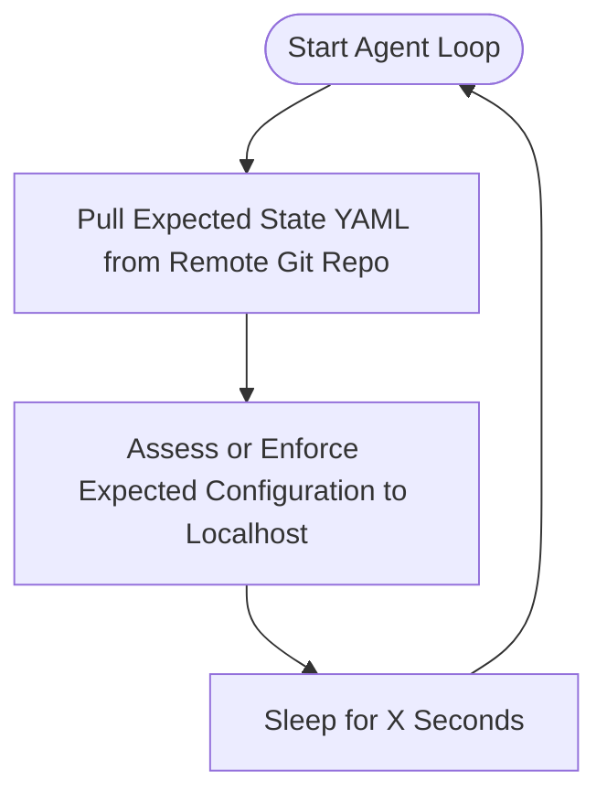

# RegOps

A lightweight GitOps agent written in Rust and built on top of the `regent-sdk` crate, designed for automated and reliable local configuration management.

## Features

* **Decentralized Configuration Management:** Hosts independently manage and enforce their own configurations, combining autonomous local execution with the control, version history, and auditability of a central Git repository.
* **System Service Native:** Full systemd integration for seamless background execution, enabling easy startup, shutdown, and persistence (`systemctl start regops`).
* **Standardized Logging:** Automatic log capture via systemd (`journalctl -u regops`), removing the need for manual file management.
* **Self-Update:** Optional auto-update from GitHub releases. When enabled, the agent periodically checks for new releases, downloads the appropriate package (.deb or .rpm), installs it, and restarts automatically.

## The reconciliation loop (dead simple)


## The CLI

### Running the Service

```bash
# Run the RegOps service permanently
regops run

# or just once
regops run-once
```

### Configuration Management

```bash
# Get current configuration
regops config get

# Initialize a new configuration file
regops config init \
  --repo https://github.com/your-org/your-repo.git \
  --branch main \
  --local-path /home/regops/repo \
  --expected-state-path expected_state.yaml \
  --mode enforce \
  --interval-sec 60 \
  --log-level info \
  --log-format raw

# Validate configuration file
regops config validate
```

### Self-Update (Auto-Update)

RegOps can update itself from GitHub releases. Enable it in the configuration file:

```toml
[Behavior]
mode = "Assess"
interval_sec = 30
auto_update = true

[AutoUpdate]
github_api_url = "https://api.github.com/repos/regent-project/regops/releases/latest"
check_interval_sec = 3600
package_format = "Auto"   # Auto, Deb, or Rpm
```

Or via the CLI:

```bash
regops config init \
  --repo https://github.com/your-org/your-repo.git \
  --auto-update \
  --github-api-url "https://api.github.com/repos/regent-project/regops/releases/latest" \
  --auto-update-check-interval-sec 3600 \
  --package-format auto
```

When `auto_update` is `true`, an `[AutoUpdate]` section is required. The agent checks the GitHub API at the configured interval, compares the latest release tag with its own version, and if a newer version exists, downloads the matching package asset and installs it via `dpkg` or `rpm` (using the service's sudo privileges). The process then exits and systemd restarts it on the new binary.

`auto_update` defaults to `false` when omitted, so existing configurations are unaffected.


## Contributing

We welcome contributions and feedback ! This project needs help with:

- **Linux distributions integration** : Right now we only ship for Debian-based distributions. We want to extend our CI to Fedora/CentOS/RHEL ecosystem, and others as well !
- **Git authentication systems** : Right now we expect the git repository to be fully accessible. We want to handle modern git authentication mechanisms.

**Join the conversation** [Regent Discord](https://discord.gg/2gxAW7uzsx)


## License

RegOps is licensed under the [Apache License, Version 2.0](LICENSE).